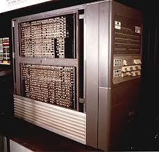
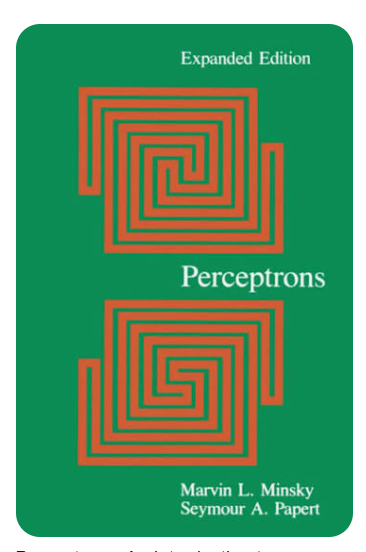
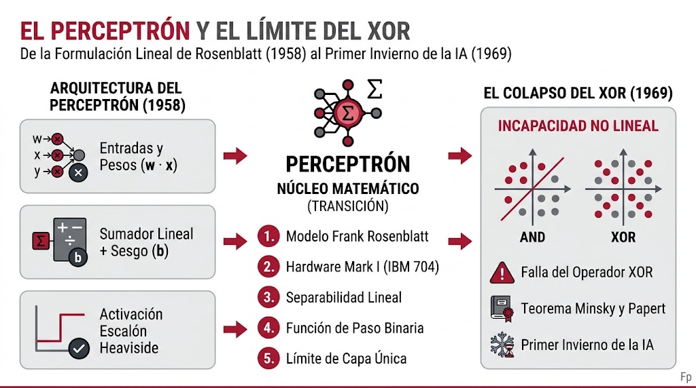
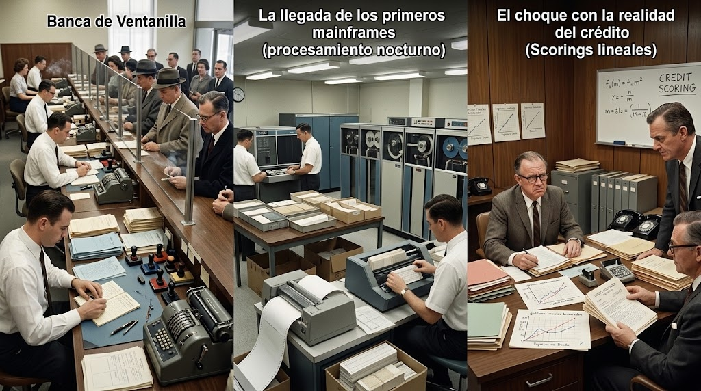
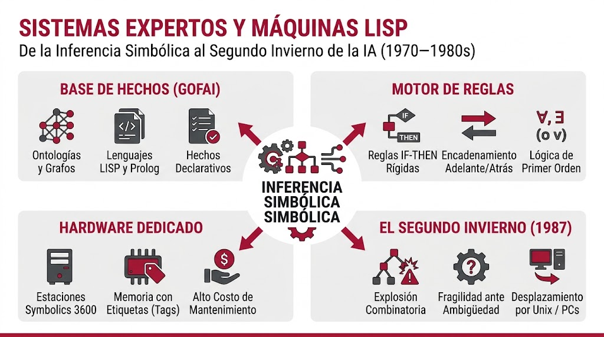
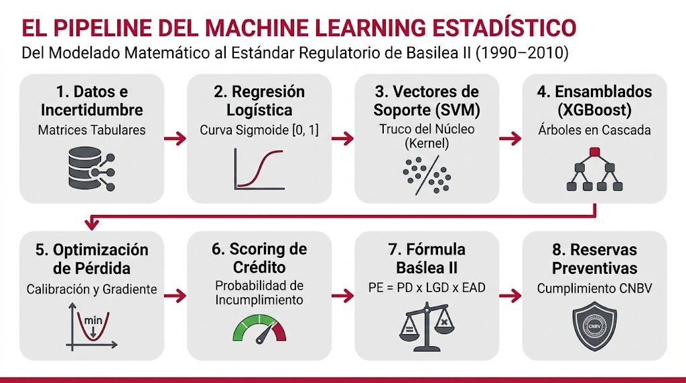
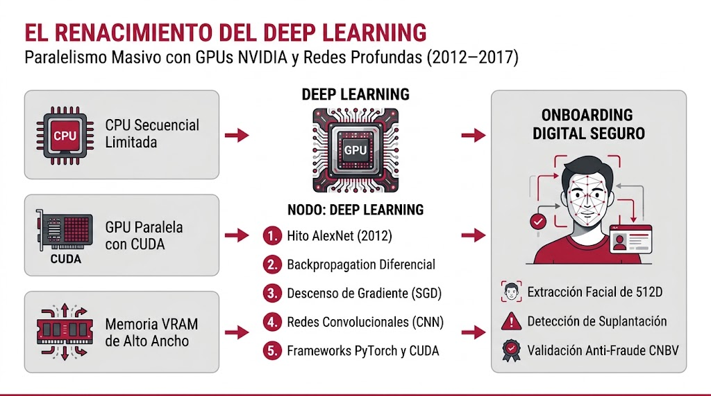
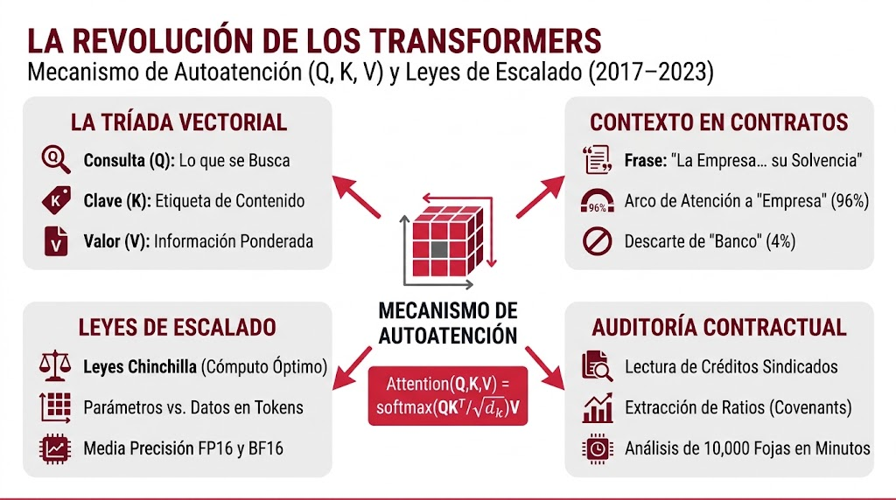
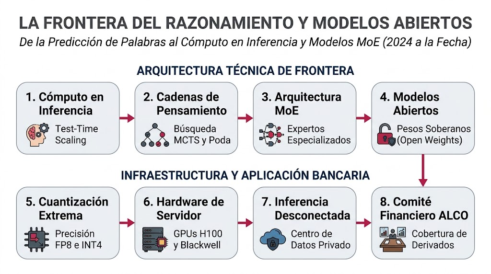

# PROGRAMA MAESTRO DE ALTA ESPECIALIZACIÓN
## Inteligencia Artificial en el Sector Financiero: De la Arquitectura de Cómputo y Algoritmos a la Regulación CNBV y Banxico

---

# MÓDULO 1: Génesis, Evolución Histórica, Hardware y Fundamentos Matemáticos (1956 al Día de Hoy)

---

## El Principio Fundamental: ¿Cómo Piensa Realmente una Máquina?
### La Fórmula Más Básica de Toda la Inteligencia Artificial Explicada con Manzanitas

Antes de abrir cualquier libro de historia de la computación o enfrentarnos a fórmulas matemáticas complejas que puedan parecer intimidantes, conviene derribar el mito más grande de todos: **la Inteligencia Artificial no es magia, no es un cerebro consciente y no requiere ser un genio para entender cómo funciona su corazón**. 

Absolutamente toda la inteligencia artificial del planeta —desde el primer prototipo de 1958 hasta los modelos masivos como ChatGPT o los algoritmos bancarios que detectan fraudes con tarjetas en fracciones de segundo— está construida sobre una sola operación aritmética elemental que cualquier persona puede comprender. Si entendemos esta pequeña receta, habremos entendido el motor secreto que mueve a todas las máquinas inteligentes.

Pensemos en cómo tomamos una decisión en la vida real. Imaginemos que un banco debe decidir si le presta dinero a una persona, o que un amigo nos pide prestado. Para tomar la decisión, no adivinamos al azar; nuestro cerebro sigue cuatro pasos muy sencillos:

1. **Las Entradas (Los Datos o "Los Ingredientes"):**  
   Son las observaciones o hechos reales del mundo exterior. En el caso de un crédito, son datos concretos: ¿cuánto dinero gana al mes la persona? ($x_1$) y ¿cuánto dinero debe actualmente en otras tarjetas? ($x_2$). Cada dato es simplemente un número observable.

2. **Los Pesos (La Importancia o "Las Perillas de Volumen"):**  
   En la vida real, no todas las pistas tienen el mismo valor. Aquí entra el concepto de **peso**: la importancia que le damos a cada dato.  
   * Que la persona tenga ingresos altos es algo positivo que suma confianza (un peso positivo y grande).  
   * Que tenga deudas vencidas es una señal de alarma que resta confianza (un peso negativo).  
   * ¿De qué color es la camisa del solicitante? Para evaluar si va a pagar un crédito, el color de su ropa no importa absolutamente nada; por lo tanto, su peso es cero ($0$).  
   Cuando en las noticias escuchamos que una inteligencia artificial está *"aprendiendo"*, lo único que la máquina está haciendo es girar lentamente esas perillas de volumen hasta encontrar la importancia exacta que debe asignarle a cada dato para no equivocarse.

3. **La Sumatoria Ponderada (Poner Todo en la Balanza):**  
   Una vez que tenemos los datos y su grado de importancia, la máquina hace lo que cualquiera haría en una libreta de almacén: multiplica cada dato por su importancia y los suma todos para obtener un puntaje único en una balanza:
   $$\text{Puntaje} = (\text{Ingreso} \times \text{Importancia del Ingreso}) + (\text{Deuda} \times \text{Importancia de la Deuda})$$

4. **El Sesgo (La Inclinación Inicial o "El Empujoncito"):**  
   ¿Qué pasa antes de que el cliente diga una sola palabra? El banco ya tiene una postura de partida. Si la economía está en crisis y el banco tiene miedo de prestar, arranca con una desconfianza previa (un sesgo negativo); el cliente tendrá que presentar datos extraordinarios para que la balanza se incline a su favor. En cambio, si el banco está en una campaña agresiva para colocar créditos, arranca con un empujón favorable (un sesgo positivo). El sesgo es simplemente la predisposición inicial de la balanza antes de mirar las pistas.

5. **La Regla de Decisión (El Interruptor):**  
   Al final del cálculo, todo se resume en un interruptor: si el puntaje final de la balanza supera una línea mínima de meta, el sistema responde **"SÍ"** (crédito aprobado, o "en la foto hay un gato", o "la transacción es legítima"). Si no supera esa línea, el sistema responde **"NO"** (crédito rechazado, o "no es un gato", o "alerta de fraude").

En resumen, la fórmula más elemental de la inteligencia artificial es simplemente:
$$\text{Decisión} = (\text{Datos} \times \text{Importancia}) + \text{Inclinación Inicial} \implies \text{Suma} \rightarrow \text{Respuesta}$$

Cualquier persona que domine esta sencilla idea ya comprende el átomo fundamental de la disciplina. Cuando en 1958 Frank Rosenblatt construyó el **Perceptrón**, utilizó exactamente esta fórmula con una sola neurona. Cuando en los años noventa y dos mil surgieron las **Redes Neuronales Profundas**, lo único que se hizo fue conectar cientos de estas multiplicaciones y sumas unas detrás de otras. Y cuando hoy interactuamos con modelos de última generación con cientos de miles de millones de parámetros, en el fondo son miles de millones de estas mismas multiplicaciones y sumas ejecutadas a velocidades vertiginosas sobre tarjetas de procesamiento gráfico. Toda la inteligencia artificial del mundo es, en esencia, esta misma suma multiplicada en escala.

---

## 1.1. El Nacimiento de la IA, el Perceptrón y el Primer Invierno: Álgebra Lineal y Cómputo Analógico (1956–1969)

Para entender verdaderamente la inteligencia artificial no basta con revisar ecuaciones; hay que situarse en la atmósfera de su época. Los años cincuenta y sesenta estuvieron marcados por la tensión de la Guerra Fría y la fascinación mundial por la carrera espacial. Era el mundo que vio el lanzamiento del satélite soviético Sputnik en 1957, el célebre discurso de John F. Kennedy en 1961 prometiendo poner un ser humano en la Luna antes de que terminara la década, y la culminación épica de esa promesa con el alunizaje del Apolo 11 en julio de 1969. En la imaginación pública de aquellos años, la ciencia no tenía límites: si el ser humano era capaz de escapar de la gravedad terrestre y navegar hacia el espacio exterior, construir un "cerebro electrónico" parecía simplemente el siguiente paso natural.

En ese clima de audacia científica se celebró la mítica Conferencia de Dartmouth (1956), donde un puñado de matemáticos y científicos de la computación acuñó por primera vez el término "Inteligencia Artificial". Poco después, en 1958, el psicólogo Frank Rosenblatt presentó en el Laboratorio Aeronáutico de Cornell el **Perceptrón**, el primer modelo formal de una neurona biológica capaz de aprender. Los primeros experimentos no corrieron en una computadora de escritorio —que ni siquiera existían—, sino en la gigantesca **IBM 704**, una máquina de bulbos y tubos de vacío que ocupaba un salón entero y consumía la energía de una pequeña fábrica.

*Figura 1-A. Gabinete de la computadora IBM 704 (1956), arquitectura sobre la cual Frank Rosenblatt simuló inicialmente el algoritmo del Perceptrón antes de construir su hardware personalizado.*

Entusiasmada con los resultados, la Oficina de Investigación Naval de los Estados Unidos financió la construcción de una máquina analógica dedicada: el **Mark I Perceptron (1958)**. Lejos de parecerse a un servidor moderno, el Mark I era un imponente banco de gabinetes metálicos conectados mediante cables y clavijas similares a los conmutadores telefónicos de la época. Tenía como "ojo" una cámara fotográfica rudimentaria con un arreglo de $20 \times 20$ fotocélulas (400 píxeles ópticos) montada sobre un tripié de madera, y sus "pesos sinápticos" eran potenciómetros físicos reales: pequeñas resistencias variables impulsadas por motores eléctricos que giraban físicamente a la izquierda o derecha conforme la máquina "aprendía" a distinguir una tarjeta marcada con un círculo de una con un triángulo.

*Figura 1-B. La máquina Mark I Perceptron en el Cornell Aeronautical Laboratory (1958), mostrando la cámara óptica sobre tripié, los paneles de clavijas de interconexión y los gabinetes de potenciómetros motorizados.*

Conceptualmente, el perceptrón operaba mediante una operación tensorial básica: multiplicaba el vector de entradas ópticas $\mathbf{x} \in \mathbb{R}^n$ por el vector de pesos $\mathbf{w} \in \mathbb{R}^n$, sumaba un sesgo escalar $b$ y evaluaba el resultado con una función de paso escalón Heaviside:

$$y = \Theta(\mathbf{w}^T \mathbf{x} + b)$$

El New York Times publicó en 1958 que el Perceptrón era *"el embrión de una computadora electrónica que pronto podrá caminar, hablar, ver, escribir, reproducirse y tener consciencia de su existencia"*. Sin embargo, el sueño chocó de frente contra la realidad matemática. En 1969 —irónicamente el mismo año en que Neil Armstrong pisaba la Luna— los matemáticos Marvin Minsky y Seymour Papert, fundadores del laboratorio de IA del MIT, publicaron su demoledor libro titulado simplemente ***Perceptrons***.

*Figura 1-C. Portada original del libro Perceptrons (1969) de Marvin L. Minsky y Seymour A. Papert, obra cumbre que demostró la limitación geométrica de las redes monocapa.*

En este libro, Minsky y Papert demostraron formalmente que el Perceptrón de una sola capa sufría de una limitación geométrica insuperable: solo podía resolver problemas que fueran linealmente separables por un plano recto. Ante patrones donde las variables interactúan de forma cruzada —como el operador lógico **XOR** ($\mathbf{x}_1 \oplus \mathbf{x}_2$)—, el perceptrón era completamente ciego. Y como en 1969 nadie sabía cómo calcular matemáticamente los gradientes de error a través de múltiples capas ocultas conectadas en cascada, la conclusión de los autores fue devastadora: las redes neuronales eran un callejón sin salida.

La consecuencia fue inmediata. Las agencias gubernamentales de Estados Unidos y Reino Unido cancelaron abruptamente el financiamiento científico, los laboratorios universitarios cerraron sus líneas de investigación de redes neuronales y la disciplina quedó sepultada en lo que la historia de la computación bautizó como el **Primer Invierno de la IA**.

*Figura 1-D. Alegoría histórica del Invierno de la IA (1969): la tecnología del Mark I Perceptron, las cintas magnéticas de carrete abierto y las tarjetas perforadas congeladas en el abandono tras la cancelación masiva de financiamiento.*

*Nota.* Representación analítica de la arquitectura del Perceptrón simple de Rosenblatt (1958) y la demostración geométrica de Minsky y Papert (1969) sobre la no linealidad del operador XOR, hito matemático que detonó el Primer Invierno de la IA. Diseño propio renderizado mediante inteligencia artificial.

### La Realidad del Mercado y la Banca en los Años Sesenta

*Figura 1-E. Tríptico de la realidad bancaria de los años sesenta: (Izquierda) La banca de ventanilla manual con libretitas de ahorro y sellos de goma; (Centro) La llegada de los primeros mainframes con procesamiento nocturno en cintas magnéticas; (Derecha) El choque con la realidad del crédito ante el fracaso de los primeros scorings lineales.*

* **La banca de ventanilla artesanal:**  
  En los años sesenta, la banca era un oficio estrictamente manual. No existían cajeros automáticos (el primero del mundo apenas se instaló en Londres en 1967), no había computadoras en las ventanillas, ni terminales punto de venta, ni tarjetas de plástico masivas. La relación entre el banco y el cliente se resumía en una **libretita de ahorros de cartoncillo**: cuando el cuentahabiente acudía a la sucursal, el cajero sacaba la ficha gemela del archivo metálico, anotaba el depósito o retiro a mano con pluma fuente o timbradora mecánica, sacaba copia en papel carbón para el expediente de la sucursal y estampaba el sello de goma en la libreta del cliente. Al final del día, el corte de caja se hacía sumando fajos de billetes y tiras de papel de sumadoras mecánicas de manivela (como las célebres Burroughs u Olivetti).

* **La llegada de los primeros mainframes (procesamiento nocturno):**  
  A mediados de la década de 1960, los grandes bancos comenzaron a adquirir computadoras como la serie **IBM 1401 y System/360**. Pero estos equipos no hacían nada parecido a "pensar" o "predecir": se utilizaban para la mecanización contable básica mediante cerros de tarjetas perforadas que se procesaban por las noches en lotes (*batch processing*) para cuadrar los cheques compensados entre bancos mediante cintas magnéticas de carrete abierto.

* **El choque con la realidad del crédito (scorings lineales):**  
  Cuando a finales de los sesenta algunos matemáticos intentaron aplicar clasificadores lineales primitivos para calificar solicitudes de crédito (scoring preliminar), la realidad financiera los desengañó rápidamente. El crédito no dependía de dos variables simples (como ingreso y saldo promedio). Un cliente con ingresos elevados pero sobreendeudado con pagarés comerciales terminaba en quiebra, mientras que un agricultor o comerciante sin ingresos fijos pero con garantías inmobiliarias pagaba puntualmente. El riesgo crediticio exigía interrelaciones no lineales, y la tecnología de los años sesenta simplemente no estaba lista para modelarlo.

---

## 1.2. La Era de la Lógica Simbólica, Sistemas Expertos y Máquinas LISP (1970–1980s)

Tras el desencanto de los modelos bioinspirados, las décadas de 1970 y 1980 marcaron la segunda gran era de la computación inteligente: la era de la IA Simbólica (*Good Old-Fashioned AI* o GOFAI). La premisa de esta época cambió de raíz: los científicos concluyeron que la inteligencia no radicaba en conectar neuronas ficticias, sino en la capacidad humana de razonar formalmente con reglas lógicas. Si se lograba extraer el conocimiento de los mejores especialistas del mundo y transcribirlo en miles de reglas lógicas, las computadoras podrían resolver cualquier dilema industrial, médico o empresarial.

Este paradigma dio vida a los **Sistemas Basados en Conocimiento** y aceleró la creación de hardware exclusivo: las **LISP Machines** (fabricadas por Symbolics y Texas Instruments), estaciones de trabajo diseñadas con procesadores especializados para manipular punteros de memoria y recolectar basura en tiempo de ejecución a nivel de silicio.

La arquitectura de estos sistemas descansaba en un desacoplamiento arquitectónico impecable entre dos módulos: por un lado, la **Base de Conocimiento**, que archivaba hechos, ontologías y miles de reglas condicionales rígidas (*IF-THEN*) en LISP y Prolog; y por el otro, el **Motor de Inferencia**, que aplicaba algoritmos deductivos por encadenamiento hacia adelante (*Forward Chaining*) o hacia atrás (*Backward Chaining*).

No obstante, esta doctrina tropezó con su propia trampa: la explosión combinatoria. A medida que una empresa añadía decenas de miles de reglas, el sistema se volvía inmanejable; una sola regla mal redactada o contradictoria provocaba fallos en cascada en el motor de inferencia. Cuando a finales de los 80 aparecieron las computadoras Unix de uso general con procesadores de silicio estándar mucho más rápidas y económicas, las costosas máquinas LISP perdieron sentido, detonando el **Segundo Invierno de la IA (1987)**.

Actualmente, estos principios siguen vivos en motores deterministas modernos como **CLIPS** (escrito en C), **Drools** (en Java) o librerías lógicas en Python (`kanren`), esenciales cuando una decisión no puede tolerar probabilidades y exige estricta trazabilidad de causa y efecto.

*Nota.* Arquitectura funcional de los Sistemas Basados en Conocimiento y hardware dedicado LISP (1970-1980s), ilustrando el desacoplamiento entre hechos, reglas y motor de inferencia, así como la explosión combinatoria que provocó el Segundo Invierno de la IA. Diseño propio renderizado mediante inteligencia artificial.

### Análisis Comparativo de Implementación
* **Caso de Estudio en Mercado Abierto:** La desaparición de las estaciones Symbolics de 100,000 dólares demostró que el hardware especializado para IA termina absorbido por microprocesadores estándar de uso común cuando los compiladores y el software comercial logran suficiente madurez y optimización.
* **Implementación en el Sector Financiero Regulado:** La banca mexicana adoptó ampliamente estos principios en sus motores de políticas duras (FICO Blaze Advisor sobre DB2/CICS). Reglas como `IF Score_Buro < 650 AND Quebranto_Previo = TRUE THEN RECHAZO_AUTOMATICO` resolvieron el control normativo, pero su mantenimiento manual requería meses de reingeniería cada vez que cambiaba una circular de crédito, careciendo de adaptabilidad ante choques macroeconómicos.

---

## 1.3. La Transición Estadística y el Aprendizaje Probabilístico (1990–2010)

Hacia la década de 1990, los científicos de datos abandonaron las pretensiones de programar el sentido común humano a mano. Con el auge de las bases de datos relacionales, el almacenamiento masivo en arreglos RAID y la digitalización de la economía, nació la era del Machine Learning estadístico. La consigna cambió por completo: en lugar de que un experto intente redactar miles de reglas, dejemos que los modelos deduzcan los patrones matemáticos analizando millones de registros empíricos bajo el rigor de la teoría de probabilidades.

Este periodo consolidó la optimización numérica sobre espacios continuos para minimizar funciones de costo (*Loss Functions*), dando vida a tres herramientas fundamentales: la **Regresión Logística Multinomial** con curvas sigmoides para estimación de probabilidades acotadas entre 0.0 y 1.0; las **Support Vector Machines (SVM)** con el *Kernel Trick* para separar hiperplanos multidimensionales complejos; y los **Modelos de Ensamblado (Random Forest y Gradient Boosting / XGBoost)**, que entrenan árboles secuenciales optimizando los residuos de error previos.

En la ingeniería moderna, estos algoritmos se despliegan de forma habitual utilizando el ecosistema de Python y C++ mediante librerías como **Scikit-Learn**, **XGBoost** y **LightGBM** sobre servidores Linux empresariales capaces de procesar millones de registros de transacciones en cuestión de segundos.

*Nota.* Pipeline secuencial de la transición estadística hacia el Machine Learning en el sector financiero (1990-2010), ilustrando el flujo matemático desde la regresión logística y modelos de ensamble hasta el cálculo regulatorio de pérdida esperada bajo Basilea II. Diseño propio renderizado mediante inteligencia artificial.

### Análisis Comparativo de Implementación
* **Caso de Estudio en Mercado Abierto:** El hito del Premio Netflix (2009) comprobó cómo la combinación de modelos probabilísticos con descomposición en valores singulares (SVD) superó ampliamente a los métodos analíticos tradicionales, demostrando que los ensamblados estadísticos son el estándar para predecir comportamientos masivos.
* **Implementación en el Sector Financiero Regulado:** Esta corriente matemática se convirtió en el estándar obligatorio de Basilea II y las disposiciones de la CNBV para el cálculo de la **Pérdida Esperada (PE = PD × LGD × EAD)**. Cada mes, las instituciones de crédito mexicanas corren estos modelos estadísticos para calificar sus carteras y constituir las reservas preventivas obligatorias que garantizan la estabilidad del capital bancario.

---

## 1.4. El Renacimiento del Deep Learning: Aceleración por GPU y CUDA (2012–2017)

Durante años, las redes neuronales profundas permanecieron arrumbadas en laboratorios académicos porque entrenarlas en procesadores convencionales (CPUs) tomaba semanas o meses. Todo cambió radicalmente a partir de 2012. Una confluencia tecnológica perfecta desató el renacimiento de la disciplina: la explosión del Big Data, el refinamiento de los algoritmos de optimización matemática y, de manera crucial, la adaptación de las tarjetas gráficas para videojuegos (**GPUs de NVIDIA con arquitectura CUDA**) hacia el cálculo científico matricial masivo.

Las CPUs tradicionales están construidas con pocos núcleos de procesamiento rápido pensados para tareas lineales y complejas; en contraste, las GPUs poseen miles de núcleos aritméticos diminutos (*ALUs*) operando en paralelo con memorias VRAM de altísimo ancho de banda. Esta capacidad desbloqueó la ejecución fluida del algoritmo de **Backpropagation** para derivar de forma continua la función de pérdida sobre grafos dirigidos, y aceleró arquitecturas profundas como las **Redes Convolucionales (CNN)** para visión artificial y las **Redes Recurrentes (LSTM/GRU)** para series temporales.

Actualmente, estos pipelines se programan a través de frameworks como **PyTorch** y **TensorFlow**, compilan kernels dedicados en **CUDA C++**, optimizan latencias de servicio mediante **TensorRT** y estandarizan sus pesos de producción mediante el formato interoperable **ONNX**.

*Nota.* Arquitectura comparativa de la aceleración por hardware (CPU vs. GPU CUDA) y el algoritmo de propagación hacia atrás (Backpropagation, 2012-2017), base técnica del deep learning moderno aplicado a la biometría y prevención de fraudes. Diseño propio renderizado mediante inteligencia artificial.

### Análisis Comparativo de Implementación
* **Caso de Estudio en Mercado Abierto:** En 2012, Alex Krizhevsky programó a bajo nivel en CUDA dos tarjetas NVIDIA GTX 580 para entrenar su red AlexNet, destrozando por más de diez puntos porcentuales a todos los algoritmos competidores en ImageNet y demostrando a la industria global que el cómputo masivo por GPU era el único camino viable para la IA moderna.
* **Implementación en el Sector Financiero Regulado:** En la banca, esta aceleración impulsó los sistemas de **Onboarding Digital y Verificación Biométrica Remota**. Redes neuronales convolucionales profundas desplegadas en servidores locales extraen vectores faciales de 512 dimensiones para cotejar la fotografía de la credencial oficial (INE) contra una prueba de vida en vivo en menos de 300 milisegundos, blindando el alta de cuentas contra la suplantación de identidad conforme a la regulación de la CNBV.

---

## 1.5. La Revolución de los Transformers y Leyes de Escalado (2017–2023)

Hacia 2017, la computación del lenguaje natural enfrentaba un obstáculo estructural: las redes recurrentes leían los textos palabra por palabra de forma secuencial. Al llegar al final de un contrato extenso, el modelo ya había degradado la memoria de los primeros párrafos y era matemáticamente imposible entrenarlas en paralelo. La publicación del célebre artículo *"Attention Is All You Need"* por investigadores de Google derribó ese muro, suprimiendo la recurrencia y dando nacimiento a la arquitectura **Transformer**, soportada por clústeres de centros de datos con GPUs **NVIDIA V100/A100** e interconexiones **InfiniBand a 400 Gbps**.

El núcleo de esta revolución es el **Mecanismo de Autoatención Multi-Cabeza**:

$$\text{Attention}(Q, K, V) = \text{softmax}\left(\frac{QK^T}{\sqrt{d_k}}\right)V$$

En este mecanismo, la interacción entre Consulta ($Q$), Clave ($K$) y Valor ($V$) calcula la afinidad matemática entre todas las palabras de un texto simultáneamente.

En la lectura de contratos bancarios, este mecanismo elimina la ambigüedad lingüística. Ante una frase como *"El banco otorgó el crédito a la empresa pero retuvo su pagaré fiduciario porque su solvencia no estaba acreditada"*, al procesar la palabra *"su"*, la autoatención proyecta más del 95% de afinidad matemática hacia *"empresa"* y apenas un porcentaje marginal hacia *"banco"*, resolviendo la referencia fiduciaria exacta.

Paralelamente, las **Leyes de Escalado (Chinchilla y Kaplan)** comprobaron que la pérdida del modelo decrece de forma predecible al balancear parámetros ($N$), tokens ($D$) y FLOPs ($C$). Asimismo, la transición a formatos de punto flotante de media precisión (**FP16** y **BF16**) permitió optimizar drásticamente el uso de memoria VRAM en servidores de inferencia con herramientas como **Hugging Face Transformers** y aceleradores **DeepSpeed**.

*Nota.* Arquitectura matricial del mecanismo de autoatención (Attention Is All You Need, 2017), detallando la interacción de Consulta (Q), Clave (K) y Valor (V) junto con las leyes de escalado de Chinchilla aplicadas a la auditoría de contratos bancarios. Diseño propio renderizado mediante inteligencia artificial.

### Análisis Comparativo de Implementación
* **Caso de Estudio en Mercado Abierto:** La evolución de modelos como GPT-3 y GPT-4 demostró que escalar parámetros a cientos de miles de millones sobre clústeres gigantescos de cómputo produce capacidades de razonamiento emergente que resuelven exámenes de grado, programación y redacción compleja con gran soltura.
* **Implementación en el Sector Financiero Regulado:** En el entorno institucional, modelos especializados en finanzas (como FinBERT) se utilizan para la auditoría de emisiones de deuda y créditos sindicados. El modelo lee expedientes de 10,000 fojas contractuales en minutos, extrayendo y tabulando compromisos de liquidez y cláusulas restrictivas (*covenants*) con cita exacta al párrafo y foja documental, reduciendo semanas de revisión legal manual a un proceso asistido de alta precisión.

---

## 1.6. La Era del Razonamiento, Modelos Abiertos y Cómputo en Inferencia (2024 al Día de Hoy)

A partir de 2024, el mundo de la inteligencia artificial cruzó una nueva frontera. El objetivo de la investigación ya no se limita a predecir la palabra estadísticamente más probable a gran velocidad, sino a dotar a los modelos de capacidad de **pensamiento crítico, autorreflexión y deducción matemática formal**. Al mismo tiempo, la maduración del software libre y los modelos abiertos permitió a las empresas operar sistemas de clase mundial en sus propias instalaciones sin depender exclusivamente de APIs comerciales extranjeras, ejecutándose sobre arquitecturas de última generación como **NVIDIA H100, H200 y Blackwell con memorias HBM3e a 8 TB/s**.

Esta frontera actual descansa sobre tres pilares de ingeniería: el **Cómputo en Tiempo de Inferencia (*Test-Time Compute*)**, donde modelos como DeepSeek R1 o la serie o1/o3 despliegan árboles de búsqueda MCTS y cadenas de pensamiento reflexivas para verificar y podar errores antes de emitir la salida; las **Arquitecturas Mixture of Experts (MoE)**, que activan dinámicamente solo a los expertos necesarios optimizando el costo computacional; y la **Cuantización Extrema (FP8 e INT4)**, soportada por frameworks como **vLLM** y compiladores **Triton** para servir modelos de enorme escala dentro de la infraestructura local del banco.

*Nota.* Pipeline arquitectónico de la frontera tecnológica actual en IA (2024 a la fecha), ilustrando el cómputo en inferencia (Test-Time Compute), arquitecturas Mixture of Experts (MoE), modelos abiertos soberanos y su aplicación en la toma de decisiones financieras colegiadas. Diseño propio renderizado mediante inteligencia artificial.

### Análisis Comparativo de Implementación
* **Caso de Estudio en Mercado Abierto:** La irrupción global de DeepSeek R1 demostró que un modelo de 671B de parámetros con pesos abiertos y arquitectura MoE, entrenado mediante algoritmos puros de aprendizaje por refuerzo, puede competir directamente contra los laboratorios más caros de Silicon Valley a una fracción del costo, democratizando la soberanía de cómputo para todo el planeta.
* **Implementación en el Sector Financiero Regulado:** Las entidades bancarias aplican esta arquitectura para crear **Comités Financieros Sintéticos (para Comités de Activos y Pasivos / ALCO)**. Un modelo abierto cuantizado en FP8 se instala dentro de servidores privados blindados (*Air-Gapped*) en el centro de datos local del banco. El sistema procesa de forma confidencial los balances diarios, las minutas de política monetaria de Banxico y los riesgos de mercado para recomendar estrategias de cobertura de derivados con fundamentación matemática auditable, garantizando al 100% el cumplimiento del Secreto Bancario (Art. 142 de la LIC).
